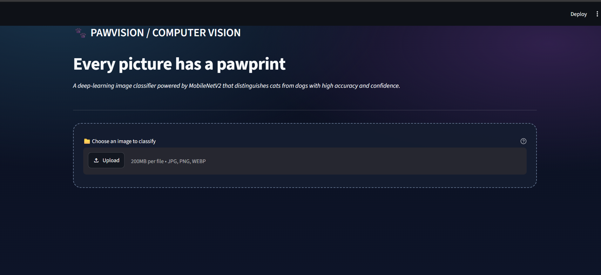
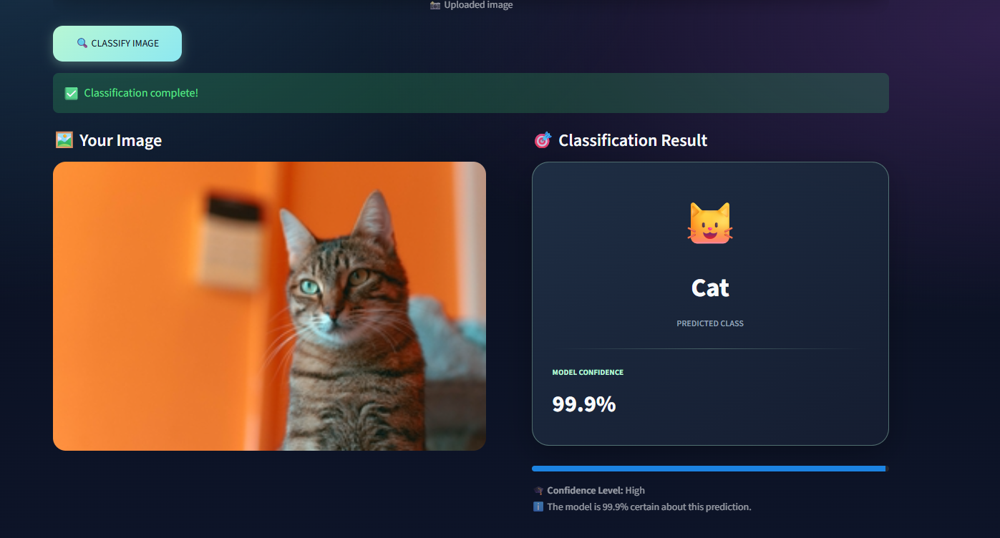
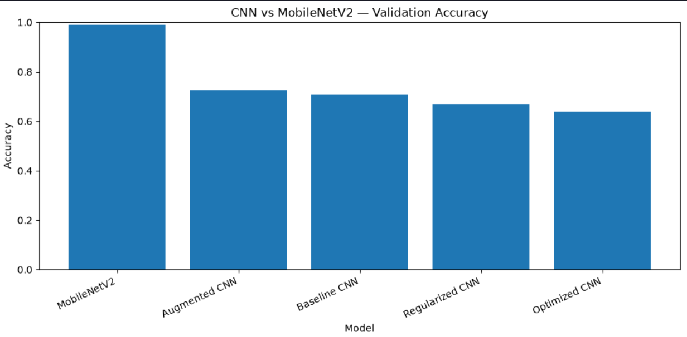
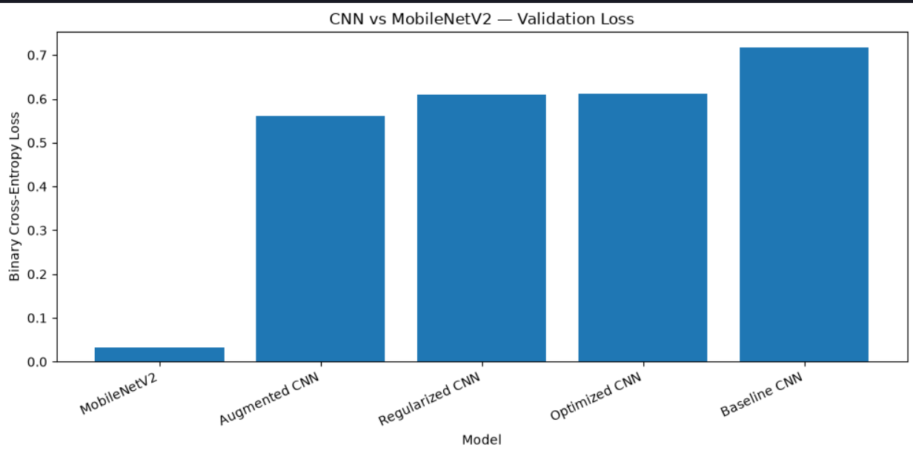
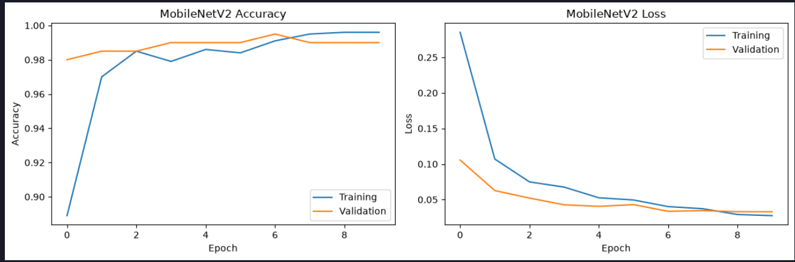

# PawVision — Cats vs Dogs Image Classifier 🐾

A deep-learning image classification project that distinguishes between cats and dogs using Convolutional Neural Networks (CNNs), transfer learning with MobileNetV2, and a Streamlit web application.

## Overview

PawVision is an image classification application that predicts whether an uploaded image contains a cat or a dog. The project explores the development and evaluation of CNN-based models, techniques to reduce overfitting, and transfer learning using a pretrained MobileNetV2 network.

The final application provides a simple interface where users can upload an image and view the predicted class along with its confidence score.

**Key features**
- Image preprocessing and dataset exploration using Python and OpenCV/TensorFlow tools.
- CNN-based binary image classification.
- Data augmentation and dropout-based regularization.
- Transfer learning using MobileNetV2.
- Model evaluation and comparison using validation data.
- Interactive image classification through Streamlit.

## Application Preview


*Figure 1: PawVision web application interface featuring the image uploader.*


*Figure 2: Example classification result showing the predicted class and confidence score.*

## Tech Stack

- **Language:** Python
- **Deep Learning:** TensorFlow, Keras
- **Data Processing:** NumPy, Pandas
- **Visualization:** Matplotlib
- **Model Evaluation:** scikit-learn
- **Image Processing:** Pillow
- **Web Application:** Streamlit
- **Development Environment:** Jupyter Notebook, VS Code

## Dataset

The project uses a subset of the Cats vs Dogs image dataset, organized into training, validation, and testing sets.

| Dataset split | Number of images | Labels |
|---|---:|---|
| Training | 1,000 | Cat and dog |
| Validation | 200 | Cat and dog |
| Testing | 100 | Unlabeled |
| **Total** | **1,300** | |

The training set contains 500 cat images and 500 dog images. The validation set contains 100 images of each class. The test images are unlabeled, so they are used to generate predictions rather than calculate test accuracy.

### Dataset organization

The dataset is stored locally in the following structure:

```text
data/
└── dogs_vs_cats_subset/
    ├── train/
    │   ├── cat.0.jpg
    │   ├── dog.0.jpg
    │   └── ...
    ├── val/
    │   ├── cat.0.jpg
    │   ├── dog.0.jpg
    │   └── ...
    └── test/
        ├── ...
```

The dataset is not included in the repository by default. Place the downloaded dataset in the expected directory before running the notebooks.

## Methodology

### 1. Dataset Exploration

The initial stage involved examining the dataset structure, class distribution, image dimensions, and sample images to understand the data before training.

### 2. Image Preprocessing

Images were loaded, converted to RGB where required, resized to the appropriate input dimensions, and prepared for model training.

- **CNN models:** Images resized to 128 × 128 pixels and pixel values normalized to the range [0, 1].
- **MobileNetV2:** Images resized to 160 × 160 pixels and preprocessed using the MobileNetV2 preprocessing function.

The preprocessing pipeline is matched to the input requirements of each model.

### 3. Baseline CNN

A baseline convolutional neural network was developed for binary classification. The network learns visual features from images through convolution and pooling layers, followed by a classification head.

The model uses a sigmoid output for binary classification and binary cross-entropy as its loss function.

### 4. Model Improvement

Several approaches were explored to improve generalization:

- **Data augmentation:** Random image transformations to expose the model to varied training examples.
- **Dropout regularization:** Reducing over-reliance on individual neurons during training.
- **Early stopping and checkpointing:** Monitoring validation performance and retaining a suitable model checkpoint.

Training and validation metrics were compared to examine learning behaviour and potential overfitting.

### 5. Transfer Learning with MobileNetV2

MobileNetV2 was used as a pretrained feature extractor. Its convolutional base was initialized with pretrained ImageNet weights and frozen while a new binary classification head was trained for the cats-versus-dogs task.

The classification head consists of global average pooling, dropout, and a sigmoid output layer.

This approach reuses features learned from a large image dataset instead of training the entire network from scratch.

### 6. Evaluation and Model Comparison

The models were evaluated on the validation set and compared using classification accuracy and loss. Additional evaluation can include a confusion matrix, precision, recall, and F1-score.


*Figure 3.1: Comparison of validation accuracy across MobileNetV2 and the baseline, augmented, regularized, and optimized CNN models.*

*Figure 3.2: Comparison of validation binary cross-entropy loss across the evaluated models. MobileNetV2 achieves the lowest validation loss among the compared models.*


*Figure 4: MobileNetV2 training and validation accuracy and loss across epochs, illustrating model convergence and validation performance during transfer learning.*

The final model is used by the Streamlit application. Its selection should be based on the recorded validation results rather than training accuracy alone.

## Results

Record the actual results from your completed model comparison before publishing this section.

| Model | Validation accuracy | Validation loss |
|---|---:|---:|
| Baseline CNN | 71.0% | 1.8487 |
| Augmented CNN | 72.5% | 0.5609  |
| Regularized CNN | 67.0% | 0.6086 |
| Best CNN checkpoint | 64.0% | 0.6114  |
| MobileNetV2 | 99.0% | 0.0328|

The values should be copied from the final evaluation output or saved model comparison CSV. Do not substitute training accuracy for validation accuracy.

## Streamlit Web Application

The application provides an interactive interface for classifying user-uploaded images.

**Workflow**
1. Upload an image in JPG, JPEG, PNG, or WEBP format.
2. The application converts the image to RGB and resizes it to the model's expected input dimensions.
3. The image is preprocessed using the appropriate MobileNetV2 preprocessing function.
4. The trained model generates a prediction.
5. The interface displays the predicted class and confidence score.

The confidence score is derived from the model's sigmoid output. It represents the model's estimated probability for the predicted class, not a guarantee that the prediction is correct.

## Project Structure

```text
mini_project2/
├── app.py
├── requirements.txt
├── README.md
├── data/
│   └── dogs_vs_cats_subset/
│       ├── train/
│       ├── val/
│       └── test/
├── models/
│   ├── baseline_cnn.keras
│   ├── augmented_cnn.keras
│   ├── regularized_cnn.keras
│   ├── best_cnn.keras
│   └── mobilenetv2_cats_dogs.keras
├── notebooks/
│   ├── 01_dataset_exploration.ipynb
│   ├── 02_model_improvement.ipynb
│   ├── 05_transfer_learning.ipynb
│   ├── 06_model_comparison.ipynb
│   └── 07_final_testing.ipynb
└── results/
    ├── baseline_results.csv
    ├── experiment_comparison.csv
    ├── final_model_comparison.csv
    └── test_predictions.csv
```

*Note: The structure above represents the intended project organization. Keep only filenames that actually exist in your project and add any additional notebooks or result files you created.*

## Installation and Setup

### Prerequisites

- Python 3.10 or another Python version supported by the installed TensorFlow release.
- pip
- The project dataset and trained model file.

### 1. Clone the repository

```bash
git clone https://github.com/soham-can/pawvision-cats-vs-dogs
cd pawvision-cats-vs-dogs
```

### 2. Create a virtual environment

On Windows:

```powershell
python -m venv .venv
.\.venv\Scripts\Activate.ps1
```

### 3. Install dependencies

```bash
python -m pip install --upgrade pip
pip install -r requirements.txt
```

### 4. Prepare the model

Ensure that the trained model is available at:

```text
models/mobilenetv2_cats_dogs.keras
```

The application must use the same preprocessing and input dimensions as the model selected for inference.

### 5. Run the application

From the project root directory:

```bash
streamlit run app.py
```

Streamlit will provide a local URL in the terminal. Open that URL in your browser to use PawVision.

## Running the Notebooks

Open the project in VS Code or Jupyter Notebook and execute the notebooks in the appropriate order:

1. Explore the dataset and inspect the images.
2. Train and evaluate the baseline and improved CNN models.
3. Train the MobileNetV2 transfer-learning model.
4. Compare model performance using validation data.
5. Generate predictions for the unlabeled test images.

Ensure the dataset paths and saved model paths match your local project structure.

## Limitations

- The dataset is relatively small, so performance may not generalize to every real-world image.
- Image quality, lighting, background, and unusual viewpoints can affect predictions.
- The test subset is unlabeled; its accuracy cannot be measured without ground-truth labels.
- Prediction confidence should not be interpreted as a guarantee of correctness.

## Future Improvements

- Expand the training dataset with more diverse cat and dog images.
- Fine-tune selected MobileNetV2 layers after training the classification head.
- Evaluate performance on a separately labeled test dataset.
- Improve error analysis using misclassified images.
- Deploy the application to a hosting platform.

## Conclusion

PawVision demonstrates an end-to-end image classification workflow, from dataset preparation and CNN experimentation to transfer learning, evaluation, and deployment through a Streamlit interface. The project provides practical experience with convolutional neural networks, regularization, pretrained image models, and interactive machine-learning applications.
